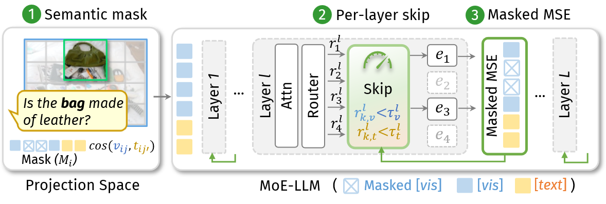

# ProSE: Probing Reconstruction Error for Semantic-guided Expert Skipping

<a href="https://arxiv.org/pdf/2611.20885">Paper</a> | <a href="https://github.com/renaissanceee/ProSE">Code</a>


<p>
    
</p>


## Citations

```shell
@article{li2026prose,
  title={ProSE: Probing Reconstruction Error for Semantic-guided Expert Skipping in MoE-MLLMs},
  author={Li, Jiameng and Wu, Minye and Blaschko, Matthew B},
  journal={arXiv preprint arXiv:2611.20885},
  year={2026}
}
```
